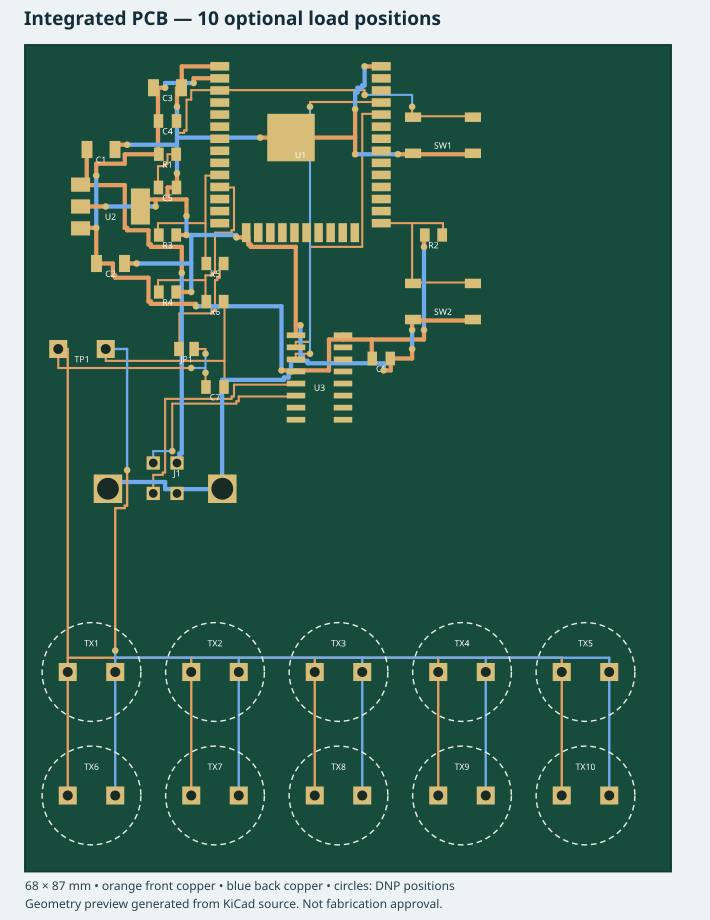

# Ultrasonic audio bench prototypes

Two independent design families, five editable KiCad projects. **These are electrical prototypes, not finished or exposure-certified speakers.** Start with a dummy capacitor and the arm link open.

| Design | Hardware | Build and test |
|---|---|---|
| [ESP32 original](designs/esp32-digital/) | External ESP32 DevKit, 5 V driver | [Build](designs/esp32-digital/BUILD.md) · [Test](designs/esp32-digital/TEST.md) |
| [ESP32 passive](designs/esp32-digital/minimum-cost/) | Four resistors; lowest additional parts cost | [Guide](designs/esp32-digital/minimum-cost/README.md) |
| [ESP32 integrated](designs/esp32-digital/integrated/) | USB power/programming, onboard ESP32, ten DNP positions | [Illustrated guide](designs/esp32-digital/integrated/BUILD_TEST.md) |
| [Analog DDS](designs/analog-dds/) | External DDS, Nano and analog line source | [Build](designs/analog-dds/BUILD.md) · [Test](designs/analog-dds/TEST.md) |
| [GreatScott reference PWM](designs/analog-dds/reference-pwm/) | Reference-derived logic controller, no power stage | [Guide](designs/analog-dds/reference-pwm/BUILD_TEST.md) |

The ten optional positions share one current-limited output, not ten independently powered channels. The passive load sweep predicts sharply reduced voltage as capacitance increases; a working ten-speaker system is not demonstrated.

## Verification

- [Original designs: CI 45840044890](https://github.com/Persie0/Playground/actions/runs/45840044890): three clean KiCad projects, ESP32 and three Arduino builds, 243 RC cases.
- [New designs: CI 45846640684](https://github.com/Persie0/Playground/actions/runs/45846640684): two clean KiCad projects, 6,480 comparison cases, 4,860 ten-load cases and 648 power sensitivity cases (106 power cases outside assumed limits).
- [Review and release gates](VALIDATION.md): 263 unique pin/net matches across five designs, all verified; physical/RF/USB/power and acoustic gates remain.

Original GreatScott Arduino sketch is committed unchanged; the supplied PDF and Gerber ZIP are verified but not yet uploaded. See [source inventory](designs/analog-dds/SOURCE_FILES.md). The owner confirms permission to reshare the attachments.

No fabrication release. No acoustic output guarantee. Do not fit an acoustic load until the separate qualified exposure and hardware review is complete.
