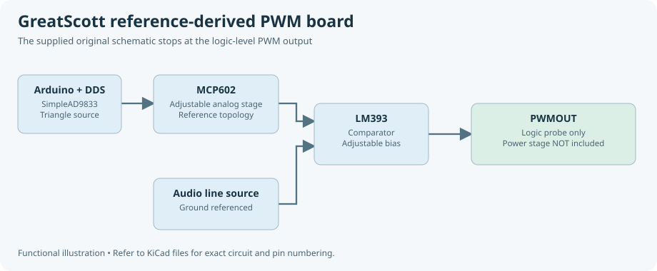
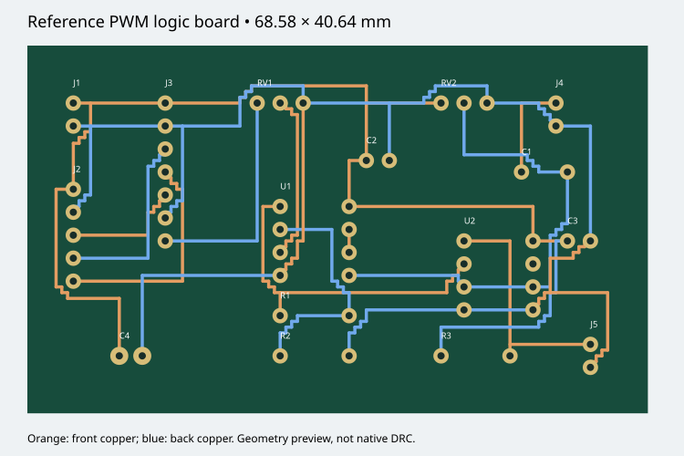

# Reference PWM logic board — build and electrical test

This guide covers only the logic controller derived from the supplied GreatScott schematic. It does not describe a complete speaker power stage.

[Parts list](bom.csv) · [KiCad schematic](reference-pwm.kicad_sch) · [KiCad PCB](reference-pwm.kicad_pcb) · [Original source inventory](../SOURCE_FILES.md)

## Before ordering

Open reference-pwm.kicad_pro in KiCad 9, run native ERC and DRC and cross-check the netlist against the original PDF. Check exact parts, potentiometer and capacitor lead pitch, power polarity and connectors. This is an unverified prototype; no fabrication approval. The source Gerbers are for a different board (transmitter), not this controller. Do not mix fabrication files.

## Assembly and firmware

Use the BOM, assemble with both external modules disconnected, inspect joints, check for supply shorts and verify the IC orientation and actual footprints. The original reference sketch depends on [SimpleAD9833](https://github.com/TheSpaceEgg/SimpleAD9833). Install the library through Arduino IDE from its GitHub archive, select the actual Nano processor/bootloader, and use the supplied AD9833.ino in a local matching-name sketch folder. A dependency-free alternative sketch is under ../firmware, not the original. Keep all acoustic hardware disconnected. The DDS module and Bluetooth line source must match their documented supply and signal ratings; never use amplified bridge-tied outputs as line input.

## Electrical-only testing

Use a current-limited regulated 5 V supply and oscilloscope, with common ground. Check supply rails before attaching modules. Inspect the DDS waveform independently, then the amplified triangle and comparator logic output with a high-impedance probe. The original reference has two adjustments, unlike the fixed-bias sibling. Do not assume adjustment-free behavior. Record rail voltages, logic output range, carrier frequency, current and temperature. Stop on abnormal heating, clipping, oscillation, unexpected current or unstable output. No emitter, power bridge or array should be attached to the logic header. Do not infer acoustic output or exposure safety from these measurements.

## Release gate

Physical assembly, mechanical review and independent native EDA validation remain outstanding. Any acoustic test requires an isolated instrumented facility and qualified exposure assessment. The original attachments do not document an exposure-certified operating limit.

## Electrical test record

| Check | Evidence |
|---|---|
| ERC / DRC | |
| Correct installed parts and polarities | |
| Regulated supply | |
| DDS waveform | |
| PWMOUT at high-impedance logic probe | |
| Output remains disconnected from acoustic hardware | |
