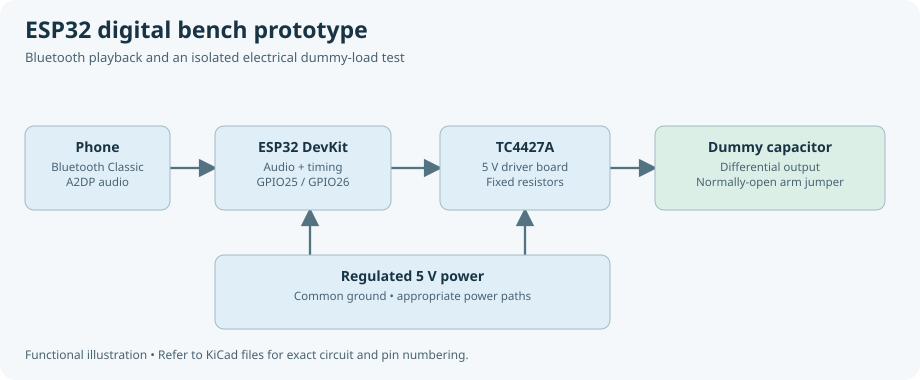
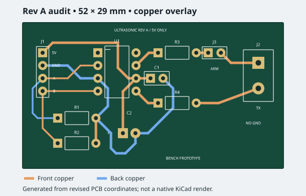

# Build the ESP32 digital prototype

> **Choose the right board:** this guide covers the original TC4427A + external DevKit. For a USB-only board, use the [integrated guide](integrated/BUILD_TEST.md). For the passive-only version, use [minimum-cost](minimum-cost/).



**Goal:** assemble and verify the electrical prototype using a dummy capacitor. Acoustic operation is a separate release gate.

[Parts list](hardware/bom.csv) · [Schematic](hardware/ultrasonic.kicad_sch) · [PCB](hardware/ultrasonic.kicad_pcb)

## 1. Obtain the parts

Use [BOM](hardware/bom.csv), a genuine original ESP32-WROOM-32 development board, TC4427A DIP-8, 5 V regulated current-limited supply, 40 kHz passive transmitter only if later approved for acoustic testing, and a dummy capacitor of nominal 2.55 nF for electrical tests. An ordinary 2.2–2.7 nF ceramic capacitor is a practical dummy. Tools: multimeter, soldering iron, oscilloscope with two channels or differential probe, USB data cable. Do not substitute an ESP32-C3/S3. No tuning potentiometers are required.

## 2. Review PCB before ordering

Open [ultrasonic.kicad_pro](hardware/ultrasonic.kicad_pro) in KiCad 9. Inspect schematic and PCB, check the local libraries, and run ERC/DRC. Verify physical footprint sizes against purchased parts, especially the terminal, capacitor and header. This remains a prototype; do not order until the checklist is reviewed. Export Gerbers and plated drills using KiCad only after review. Standard 2-layer, 1.6 mm FR4, 1 oz copper. No special stackup. The PCB is 52 × 29 mm.



## 3. Assemble without transmitter

Solder low-profile resistors first, then socket (optional), ceramic capacitor, headers, terminal and electrolytic. Match the polarity mark and DIP notch; check pin 1 before inserting driver. Leave J3 open. Inspect for bridges and check 5 V-to-ground resistance unpowered. See [assembly](hardware/assembly.md) for connector wiring and release gates.

## 4. Program ESP32

Install ESP-IDF v5.4.2 using Espressif's official installation guide, activate its environment, then run from this design folder:

```sh
cd firmware
idf.py set-target esp32
idf.py build
idf.py -p /dev/ttyUSB0 flash monitor
```

Replace the serial port with your actual port. Program with the driver disconnected. Do not use external 5 V and USB simultaneously unless the board has documented isolation. The Bluetooth device name is Ultrasonic Rev A; pair only in a controlled lab. Standard A2DP SBC 44.1/48 kHz stereo is accepted.

## 5. Wire the driver

| J1 pad | Signal | Destination |
|---:|---|---|
| 1 | 5 V | Regulated power, according to board documentation |
| 2 | GND | Common ground |
| 3 | PWM_A | GPIO25 |
| 4 | PWM_B | GPIO26 |

**Before powering:** inspect soldering, check orientation, confirm J3 open and verify the load is absent.


J1 pin 1: 5 V; pin 2: common ground; pin 3: ESP32 GPIO25; pin 4: GPIO26. Follow the development board's documented power input. J2 is differential, not ground-referenced. Keep J3 open and J2 disconnected until the electrical tests. Do not attach a speaker or array. Continue to [TEST.md](TEST.md).
