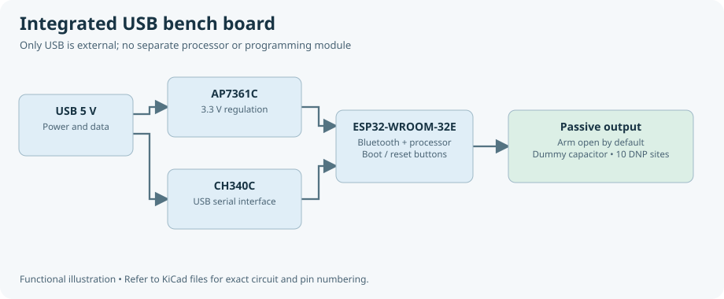
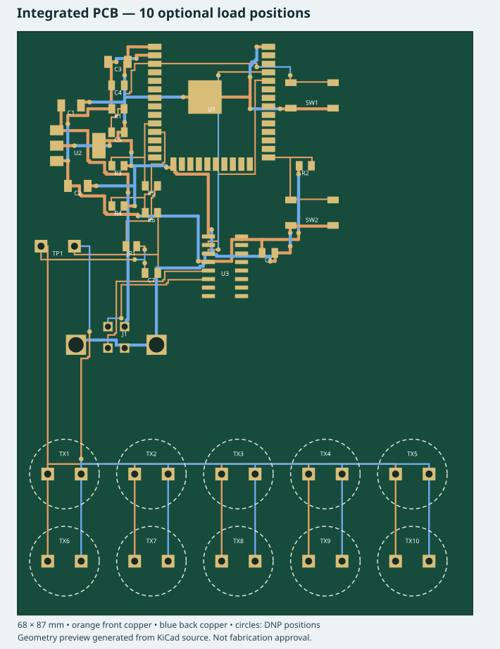
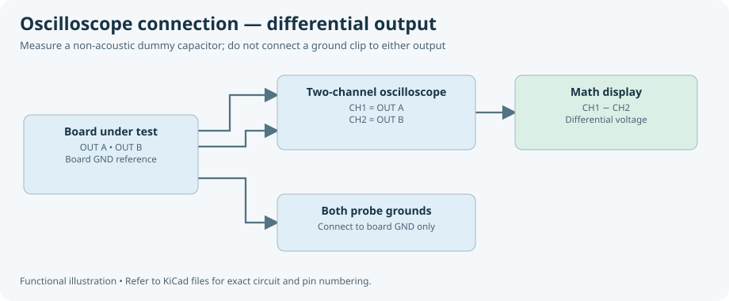

# Build and test the integrated USB board

**Use this guide for the onboard ESP32/USB revision.** The ten load positions are DNP; no external DevKit or programmer is needed. Default population is C7 only and JP1 open.

[Parts list](bom.csv) · [Schematic](integrated.kicad_sch) · [PCB](integrated.kicad_pcb) · [Power model](power_simulation.md) · [Ten-load model](ten_load_simulation.md)

## Before ordering
Open integrated.kicad_pro in KiCad 9. Run ERC and DRC; cross-check all pads, USB connector variant and package mechanical drawings. Inspect ground return, regulator thermal copper, antenna overhang, exposed-pad paste and USB routing. Native checks passed, but physical verification remains required before fabrication. Do not order this prototype as a finished assembly. No Gerbers are released. Use standard two-layer FR4, 1.6 mm, 1 oz copper.

## Assembly
Use the BOM. Fit the original ESP32-WROOM-32E-N4, fixed AP7361C-33E-13 (not SOT223R), CH340C, USB-B connector, reset/boot switches and passive parts. Fit C7 as the dummy capacitor. Leave TX1–TX10 and TP1 unpopulated and JP1 open. Verify orientation and solder bridges before power. Use a verified current-limited 5 V bench source through the USB connector for initial electrical bring-up. USB host current compliance remains unverified; do not connect to an arbitrary host before power review. No external DevKit, UART programmer, DDS, clock or audio module needed. Check 3.3 V rail and USB enumeration before flashing.

## Firmware
Use ESP-IDF 5.4.2 and the existing firmware folder. With JP1 open, hold BOOT, press/release RESET, release BOOT; use the enumerated CH340 serial port and manual boot mode to flash. From the digital firmware directory, build with `idf.py set-target esp32` and `idf.py build`. The USB bridge has no auto-reset circuit. Use manual boot mode and esptool's manual reset options if flashing fails; confirm the port and actual device, then reset normally. Pair with Ultrasonic Rev A. Keep the transmitter absent.

## Electrical acceptance

Run `python3 power_sweep.py` and `python3 ten_load_sweep.py`, plus the existing RC sweeps from the parent simulation folder. The model has failed regulator corners; do not treat a successful script as hardware acceptance. Measure USB input, 3.3 V rail and current at boot, idle and Bluetooth playback, with calibrated instruments. Confirm no brownouts, rail below-limit excursions, excessive heating or unexpected sustained output. Verify actual regulator junction temperature indirectly using suitable thermal measurement and datasheet guidance; modeled limits are not a release. Power down and bridge JP1 only for an isolated dummy-load measurement. Probe both output nodes relative to ground using two channels and math subtraction; never ground a differential terminal. Confirm pause/disconnect muting and bounded output. Remove the bridge after test. Do not fit an acoustic transmitter until qualified exposure assessment and physical review. No increase in output or external amplifier is included. All ten acoustic positions remain DNP.

## Record results

| Check | Expected | Measured / pass-fail |
|---|---|---|
| PCB ERC/DRC | No violations | |
| JP1 / TX population | Open / all DNP | |
| USB input | Regulated 5 V within source specification | |
| 3.3 V rail | Stable throughout startup and streaming | |
| USB enumeration | CH340 serial device | |
| Idle or disconnected | Both outputs low | |
| Regulator temperature | Within verified board-specific design limit | |
| Acoustic release | Separate qualified assessment required | |

## Stop conditions

| Observation | Response |
|---|---|
| Unexpected rail droop or resets | Remove power; do not continue with playback |
| Excessive regulator temperature | Remove power; review power/thermal design |
| USB not enumerating | Check the port, cable and power review; do not bypass supply limits |
| Unknown module or regulator variant | Verify exact manufacturer part and footprint before assembly |
| Output active while disconnected | Remove power and open JP1; do not attach an acoustic load |

See [release gates](../../../VALIDATION.md).
