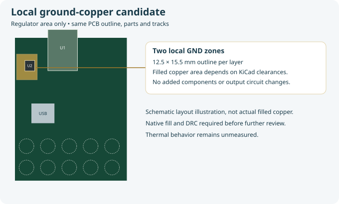

# Local ground-copper candidate and layout audit

The integrated USB prototype has an existing routed ground network but no copper pours. This is a power/ground review only; output drive, load footprints, firmware, component values and the validated board are unchanged.

## Actual geometry audit (validated baseline)

| Net | Total routed segment length (mm) | Segment count | Minimum width (mm) |
|---|---:|---:|---:|
| GND | 193.555 | 103 | 0.45 |
| 3V3 | 97.880 | 46 | 0.45 |
| VBUS | 44.387 | 19 | 0.45 |
| USB_DP | 26.718 | 13 | 0.22 |
| USB_DM | 22.098 | 9 | 0.22 |

These are sums of segment lengths (including stubs, excluding via barrel length), not end-to-end resistance, impedance or measured signal skew. The two USB net totals differ by 4.619 mm; neither the impedance nor the complete return-current path is qualified. The board has 19 existing GND vias.

## Candidate

[generate_power_copper.py](generate_power_copper.py) produces a separate candidate PCB with two local GND copper-zone outlines, one on each copper layer, in the regulator area (x 51–63.5 mm, y 60–75.5 mm in the board coordinate system). Each outline covers 193.75 mm² before clearances, pad/track subtraction and island removal. The goal is to investigate additional local ground copper and heat-spreading paths without changing the circuit or adding parts. This is not a board-specific thermal model or a guarantee of improved junction temperature. No acoustic output change is made.

The source generator refuses to overwrite the existing board, rejects a board with pre-existing zones and checks that all original text other than the two inserted zone definitions is retained. In KiCad, copy the integrated project into a separate directory, use the generated candidate as its PCB, refill zones, inspect both layers and run native DRC and schematic parity. The public CI will do this with the native KiCad API and retain reports. No Gerbers are generated. The candidate is not a manufacturing revision.

## Unresolved RF and USB

Espressif recommends placing the module antenna outside the base PCB; where that cannot be achieved it recommends at least 15 mm clearance around the antenna area. The current board's overhang is not a measured antenna clearance qualification. The local zones are outside the nominal module body, but the exact land pattern, feed location, copper/ground return, enclosure and antenna performance still need review. No RF ground plane across the complete board has been qualified. The USB pair still needs its controlled return path, impedance, ESD and power compliance reviewed.

Reference: [Espressif ESP32 PCB layout guidelines](https://docs.espressif.com/projects/esp-hardware-design-guidelines/en/latest/esp32/pcb-layout-design.html); [KiCad 9 PCB editor — copper zones and DRC](https://docs.kicad.org/9.0/en/pcbnew/pcbnew.html).

## Release gates

Retain the original 756-case power screening and the power-only diagnostic as separate evidence. A filled-zone DRC pass does not resolve any of the failed thermal or transient corners. Board-specific measurements and a suitable USB/RF review are required. All acoustic sites remain unpopulated and the arm open.
