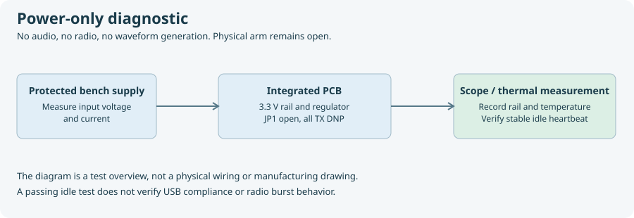

# Integrated PCB — power-only bring-up



This procedure is for initial electronics verification, with JP1 open, TX1–TX10 and TP1 unpopulated. No acoustic load or audio firmware. Do not use a computer USB port until USB power review has been completed. Use suitable protected, current-limited bench power and appropriate instruments; no fabricated unit has been verified.

## 1. Inspect first

Review the exact manufacturer's pinout and footprint for U1–U3, solder joints, polarity and connector. Check for unpowered shorts. Confirm that the board and enclosure do not obstruct the antenna. No manufacturing release is claimed.

## 2. Baseline power

Measure the USB input and the 3.3 V rail at the supply and module. Record the actual steady supply current and startup waveform. Stop on unexpected current, rail instability or heating. A scope and thermal measurement are required; firmware cannot measure either quantity without external instruments.

## 3. Diagnostic firmware

The [power-diagnostic](power-diagnostic/) project is separate from the audio firmware. Build using ESP-IDF 5.4.2 with the esp32 target:

```sh
cd power-diagnostic
idf.py set-target esp32
idf.py build
```

Once the power/programming interface has been verified, program via the documented manual boot/reset sequence using the appropriate serial interface. The diagnostic does not initialize Bluetooth or produce a carrier. Confirm serial heartbeat and reset reason. The printed `arm open` text is an operator instruction, not sensed hardware state. There is no arm-position sensor; verify JP1 physically before every test. GPIO configuration begins after application startup; the hardware pull-downs and open arm are still required during reset. Both output pins should remain low, but the physical open arm is still mandatory.

## 4. Record and stop

| Observation | Result / instrument / conditions |
|---|---|
| Input rail, startup waveform | |
| 3.3 V rail, startup waveform | |
| Idle supply current | |
| Regulator surface temperature and ambient | |
| Reset reason and heartbeat | |
| Output pins low | |
| Arm open and acoustic positions DNP | |

If the baseline fails, do not progress to the audio firmware. Passing this test does not establish USB compliance, radio burst behavior, acoustic safety or a release for manufacture. Keep the output disarmed.

## 5. Save the evidence

Use [power-measurements.csv](power-measurements.csv) for the measurement record, with one row per condition and instrument configuration. Preserve oscilloscope captures separately and reference the filenames. Enter actual measured values only; never substitute the simulation values. Record board revision, component lot and ambient conditions, including measurements that fail. Blank readings mean unmeasured, not zero. See [POWER_REVIEW.md](POWER_REVIEW.md) for the screening assumptions; the model thresholds alone do not define hardware acceptance.
