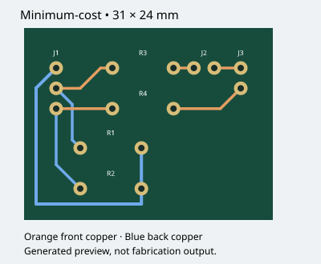
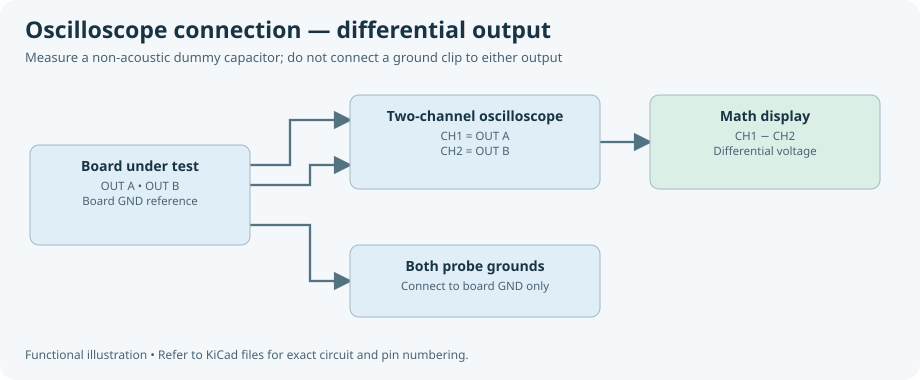

# Minimum-cost passive-only ESP32 bench interface

Independent lower-output variant of the validated TC4427A board. Same firmware and original ESP32 DevKit; no extra IC or 5 V power input on this PCB. Four resistors, three inexpensive headers and one removable shunt. 31 x 24 mm, two layers, 15 pads, 18 tracks, no vias. Static clearance minimum 0.746 mm and all six nets connected; native KiCad ERC/DRC passed with zero violations in [run 45846640684](https://github.com/Persie0/Playground/actions/runs/45846640684). All 15 unique pin IDs matched PCB nets. Estimated passive BOM EUR 0.15–0.70 before shipping, PCB and ESP32; prices are planning assumptions rather than quotes. The cheapest electrical prototype uses existing breadboard/jumper wires instead of ordering a PCB. This board is not a performance-equivalent alternative to the TC4427A; lower voltage and higher series resistance substantially reduce output. It is intended for isolated capacitive dummy loads only until physical validation and an appropriate acoustic exposure review. Never connect an array, amplifier, external supply or grounded load to the output.

## Build and test

Inspect the KiCad project, verify ERC/DRC and physical component fit before ordering. Solder four resistors and headers; leave J2 open. J1 pin 1 common ground, pin 2 GPIO25, pin 3 GPIO26. No 5 V or 3.3 V supply pin. J3 is differential, neither pin is ground. Flash the unchanged [ESP32 firmware](../firmware/) with the board disconnected. Power only the DevKit normally; check the pins at idle and during streaming with an oscilloscope referenced only to DevKit ground. Power off, fit a nonpolar 2.2–2.7 nF dummy capacitor at J3, and close J2 only during supervised electrical tests. Verify boot/pause/disconnect muting, check each GPIO output and differential voltage with two grounded channels and math subtraction, record current and temperature, then power off and remove the jumper. No acoustic validation or manufacture approval. See [simulation](../simulation/minimum_cost.md).

Physical and acoustic validation remain pending. See [review](../../../VALIDATION.md).
